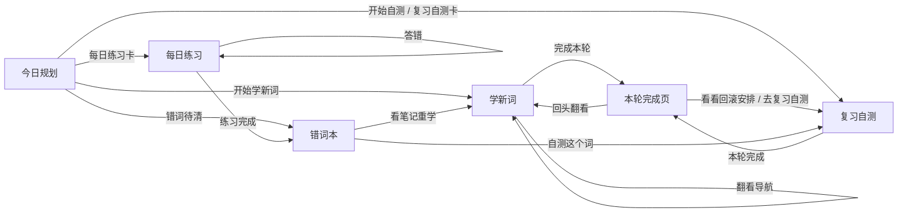

# 词阶 · 30 天背单词软件 — 产品需求文档（PRD）

> 版本：V1.0
> 日期：2026-11-19
> 适用范围：桌面端（`背单词设计/index.html`，产品名「词阶」）与移动端（`背单词设计/mobile.html`，产品名「墨记」）
> 说明：本文档由 HTML 原型逆向输出，只描述三件事——**要素（有什么）、交互（点击去哪）、数据来源（数据从哪来）**，不描述视觉样式。

---

# 需求概述

## 需求背景

为江苏联盟学位英语备考提供一款 30 天高频词背诵工具。核心诉求：

1. 每日任务明确：每天学固定一批新词（词量来自词库原始分配，不自动计算）。
2. 抗遗忘：学过的词按艾宾浩斯间隔阶梯（1/2/4/7/15/30 天）自动回滚，到点回到眼前。
3. 错词闭环：自测、练习中答错的词自动收进错词本，连对两次自动移出。
4. 助记卡格式固定：拆件 / 一秒记住（或提示）/ 挂句 / 辨析 + 拓展派生，内容逐字来自《学位英语六步记忆卡》词库。
5. 离线可用：单文件 HTML，数据存本机 localStorage。

## 功能清单

| 所属端 | 页面 | 主要功能点 |
|:---:|:---|:---|
| PC / 移动 | 今日规划（今日） | 进度环、三项统计、30 天进度格、学习/复习/练习任务卡 |
| PC / 移动 | 学新词（学词） | 摊开一页式学习卡（词条+助记卡）、前后翻看、完成本轮、自动朗读、英美音切换 |
| PC / 移动 | 复习自测（自测） | 先回想再揭晓、想起/没想起判定、本轮答错词末尾重考 |
| PC / 移动 | 回滚复习页（仅 PC） | 间隔阶梯展示、遗忘曲线科普、今日到期队列分组 |
| PC / 移动 | 每日练习（练习） | 看词选义四选一、第 3 题起中译英变式、答错当场补考并进错词本 |
| PC / 移动 | 错词本（错词） | 错词清单、看笔记重学、单词条自测 |
| PC / 移动 | 时间机器（演示组件） | 天数滑块、填充演示进度、清空重来 |

## 页面导航关系

## 公共规则

1. **词库来源**：全部词条内容来自《学位英语六步记忆卡》JSON，共 1877 词，按 30 天分配（D1–D29 各 62~63 词，D30 为 57 词），总分配表为常量 `DAYS`。
2. **词分三档**（tier）：
   - `f` 完整卡：释义 + 拆件（词素拆解）+ 一秒记住（助记）+ 挂句（例句）+ 辨析（易混/用法）；
   - `l` 轻卡：释义 + 提示（记法/词组/联想）+ 挂句；
   - `s` 跳过卡：仅释义，无助记栏。
3. **助记卡渲染口径**：标签栏依次为 拆件 / 一秒记住（f）或 提示（l）/ 挂句 / 辨析；无该栏则整行不渲染。
4. **回滚机制**：间隔阶梯 `INTERVALS=[1,2,4,7,15,30]`。新词学过 → 明天到期；自测/练习答对且连对 2 次 → stage 升 1 阶、按阶梯顺延；答错 → wrong+1、stage 归 0、明天到期且进错词本、本轮末尾重考。
5. **到期上限 REV_CAP**：每日到期复习词取「错词优先、按到期日排序」的前 REV_CAP（≥ 每日新词×2）个。
6. **完成判定**：新词「下一个」时记 learned；当日任务（新词+到期复习）每词记录完成日，今日完成率 = 已完成/总任务。
7. **数据存储**：localStorage，PC 端 KEY=`cijie_v4`，移动端 KEY=`cijie_m2`；不可用时自动降级为内存存储，功能不中断。两端存档互不通用。
8. **发音**：Web Speech API（speechSynthesis），语速 0.85，支持美音 en-US / 英音 en-GB 切换；学习/自测卡默认自动朗读（可关）。
9. **演示数据**：时间机器为演示专用组件，正常使用停在真实天数；「填充演示进度」预置前 11 天已学状态，便于体验回滚与错词本。

---

# 一、今日规划页（PC `v-today` / 移动 `v-today`）

## 1.1 页面要素总览

| 序号 | 区块 | 原型ID（PC） | 原型ID（移动） | 说明 |
|:-:|:---|:---|:---|:---|
| 1 | 今日主卡（进度环） | `today-hero`（ring/hero-txt） | `card.hero` | 完成率环 + 第 N 天 + 状态描述 |
| 2 | 统计行 | `stat-row` | `card.stats` | 今日新词 / 到期复习 / 错词待清 |
| 3 | 30 天进度格 | `cal`（cal-wrap） | `cal` | 30 格进度，绿=已学、红=今天、金点=有词到期 |
| 4 | 任务卡 | `task-card` | go-card × 3 | 学新词 / 复习自测（移动端多一张每日练习卡） |

## 1.2 各区块要素与交互

### 1.2.1 今日主卡
**要素**：完成率圆环（百分比 + 「今日完成」）、第 N 天 / 30、状态一句话（如「今天 62 个新词，30 个旧词到期」）。

**数据来源**：今日完成率 =（新词+到期复习中已完成数）/ 总任务数，总任务数=0 时显示 100%；状态句按新词数、到期数分三档文案；天数取当前演示天数 `day`。

### 1.2.2 统计行
**要素**：今日新词数 / 到期复习数 / 错词待清数。

**数据来源**：今日新词=`WORDS` 中 day=当天 的词；到期复习=`revWords(day)`（已学且 due≤今天，按错词优先+到期日排序，截取 REV_CAP）；错词待清=`wrong>0` 的词总数。

### 1.2.3 30 天进度格
**要素**：30 个格子，每格显示天数与 ✓（该天有任务完成过）；状态类：today（当天）/ done（已过或有完成记录）/ future（未来）/ due（该天有词到期，金点）。

**交互**：纯展示，无点击跳转。

**数据来源**：完成记录取存档 `S.done`（值=完成日）；到期标记取存档 `S.st[w.id].due`。

### 1.2.4 任务卡
**要素与交互**：

| 元素 | 交互 |
|:---|:---|
| 「开始学新词」卡（NEW） | 点击 → 跳转**学新词页**（队列=今日新词） |
| 「开始自测」卡（REVIEW，移动端「复习自测」） | 点击 → 跳转**复习自测页**（队列=到期旧词∪错词） |
| 「每日练习」卡（仅移动端） | 点击 → 跳转**每日练习页** |
| PC「看看回滚安排」按钮 | 点击 → 跳转**回滚复习页** |

**数据来源**：卡上数字取 1.2.2 同口径计数。

## 1.3 要素核对清单

| 区块 | 原型要素 | 文档是否覆盖 |
|:---|:---|:---:|
| 今日主卡 | 进度环/百分比/第N天/状态句 | ✅ |
| 统计行 | 新词/到期/错词三计数 | ✅ |
| 进度格 | 30格/✓/四态/金点 | ✅ |
| 任务卡 | 新词卡/自测卡/（移动）练习卡/回滚入口 | ✅ |

---

# 二、学新词页（PC `v-study` 学习模式 / 移动 `v-learn` 学习模式）

## 2.1 页面要素总览

| 序号 | 区块 | 原型ID（PC） | 原型ID（移动） | 说明 |
|:-:|:---|:---|:---|:---|
| 1 | 顶栏 | `study-bar` | `subbar`+`progline` | 模式芯片、进度 n/总、进度线、朗读开关（PC） |
| 2 | 学习卡 | `note-sheet` | `noteCard` | 词条头 + 释义 + 助记卡（摊开一页） |
| 3 | 翻页导航 | `note-nav` | `nav3` | 上一个 / 完成本轮 / 下一个 |
| 4 | 本轮完成页 | `study-done` | `learnDone` | 完成提示 + 回头翻看 + 去复习 |

## 2.2 各区块要素与交互

### 2.2.1 顶栏
**要素**：模式芯片（学新词 / 重看笔记 / 自测中）、进度「n / 总数」、进度线、自动朗读开关、美音/英音切换（PC）。

| 元素 | 交互 |
|:---|:---|
| 自动朗读开关（PC） | 勾选/取消；勾选时立即朗读当前词 |
| 美音 / 英音（PC） | 切换 accent 并立即重读当前词 |

### 2.2.2 学习卡（摊开一页）
**要素**：
- 词条头：单词、音标、🔊 听发音按钮；
- 释义区：每行 词性+中文释义，重点释义带标记；
- 助记卡（按 tier 渲染）：拆件 / 一秒记住 或 提示 / 挂句 / 辨析。

| 元素 | 交互 |
|:---|:---|
| 🔊 听发音 | 朗读当前单词（全局监听 data-speak-w） |
| 空格键（PC） | 朗读当前词 |

**数据来源**：当前词 = 队列 `learnQueue[learnIdx]`；队列=今日新词（模式 new）或重学单词条/复习队列（模式 rev）；卡片内容逐字取词库对应字段（ety/mem/hint/ex/nua）。

### 2.2.3 翻页导航
| 元素 | 交互 |
|:---|:---|
| ← 上一个 | 回看前一个词（到头则绕回最后一个）；纯翻看不计完成 |
| 下一个 → | 当前词记 learned（首次见过则入回滚队列，明天到期）；到末尾则进入**本轮完成页** |
| 完成本轮 ✓ | 直接进入**本轮完成页** |
| ← 上一个 / → 键（PC） | 同上翻页 |

**数据来源**：完成记录写入 `S.done[w.id]=day` 与 `S.st[w.id]`（seen=true、stage=0、due=day+1）。

### 2.2.4 本轮完成页
**要素**：✓ 图标、标题、完成说明文案。

| 元素 | 交互 |
|:---|:---|
| ← 回头翻看刚学的词 | 回到学习卡第 1 个词（重看不计完成） |
| 看看回滚安排 →（PC）/ 去复习自测 →（移动） | 跳转**复习自测页** |

**数据来源**：文案按本轮队列长度动态生成。

## 2.3 要素核对清单

| 区块 | 原型要素 | 文档是否覆盖 |
|:---|:---|:---:|
| 顶栏 | 芯片/进度/进度线/朗读开关/音色 | ✅ |
| 学习卡 | 词头/音标/发音/释义/四栏助记 | ✅ |
| 翻页导航 | 上一个/完成/下一个/键盘 | ✅ |
| 完成页 | 提示/回头翻看/去复习 | ✅ |

---

# 三、复习自测页（PC `v-study` 自测模式 + `v-review` / 移动 `v-learn` 自测模式）

## 3.1 页面要素总览

| 序号 | 区块 | 原型ID（PC） | 原型ID（移动） | 说明 |
|:-:|:---|:---|:---|:---|
| 1 | 回滚复习首页（仅 PC） | `v-review` | —（移动直接进自测） | 阶梯/曲线/队列/开始自测 |
| 2 | 回想卡 | `recallPane` | `recallPane` | 单词先展示，答案遮盖 |
| 3 | 揭晓区 | `recallAnswer` | `recallAnswer` | 释义 + 助记卡 |
| 4 | 判定按钮 | `recallActions` | `recallActions` | 没想起来 / 想起来了 |

## 3.2 各区块要素与交互

### 3.2.1 回滚复习首页（仅 PC，`v-review`）
**要素**：
- 主视觉：标题、第 N 天、今日到期数、间隔阶梯（1→2→4→7→15→30 天→长期）；
- 「开始今天的自测」按钮；
- 遗忘曲线科普折叠区（曲线图 + 一句话看懂回滚）；
- 「今天该见哪些旧词」队列面板（按「昨天/两天前/四天前/一周前/半月前/一个月前学的」分组）。

| 元素 | 交互 |
|:---|:---|
| 开始今天的自测 | 跳转**复习自测页**（自测模式） |
| 遗忘曲线折叠开关 | 展开/收起科普区 |
| 队列词块 | 纯展示（title 为释义），无点击跳转 |

**数据来源**：到期数=`revWords(day)` 计数；队列分组=`dueGroups(day)` 按当前 stage 对应间隔分组。

### 3.2.2 回想卡
**要素**：模式芯片（回忆练习 / 刚才没想起·再来一次）、单词、音标、🔊、提示语、「显示答案与记法 ↓」按钮。

| 元素 | 交互 |
|:---|:---|
| 显示答案与记法 ↓ | 展开**揭晓区**，按钮变「答案就在上面」，提示语改为对照文案；出现判定按钮 |
| 先跳过这个词 | 跳过当前词不判定，进入下一个 |
| 🔊 / 空格键 | 朗读当前词 |

### 3.2.3 揭晓区
**要素**：释义（重点标记）+ 按 tier 渲染的助记卡。纯展示。

### 3.2.4 判定按钮
| 元素 | 交互 |
|:---|:---|
| 没想起来 · 等下再来 | wrong+1、stage 归 0、明天到期、进错词本；该词在本轮末尾重考（芯片变「再来一次」）；toast 提示 |
| 想起来了 → | streak+1；连对 2 次则 stage 升 1 阶、按阶梯顺延到期日；若为重考成功则 toast「连对两次就放它走」 |
| 数字键 1/2（PC） | 等价于「没想起来」/「想起来了」 |

**数据来源**：自测队列 = 到期旧词（revWords）∪ 错词（wrong>0），按 id 去重；判定结果经 `markRecall(w,ok)` 写入存档。

## 3.3 要素核对清单

| 区块 | 原型要素 | 文档是否覆盖 |
|:---|:---|:---:|
| 回滚首页（PC） | 阶梯/按钮/曲线折叠/队列分组 | ✅ |
| 回想卡 | 芯片/词/音标/发音/揭晓按钮/跳过 | ✅ |
| 揭晓区 | 释义/助记卡 | ✅ |
| 判定 | 两个按钮/键盘/重考 | ✅ |

---

# 四、每日练习页（PC `v-quiz` / 移动 `v-quiz`）

## 4.1 页面要素总览

| 序号 | 区块 | 原型ID（PC） | 原型ID（移动） | 说明 |
|:-:|:---|:---|:---|:---|
| 1 | 练习头 | `quiz-head` | `subbar` | 进度 n/总 |
| 2 | 题卡 | `quiz-card` | `quiz-card` | 题干（词或释义）+ 音标 + 🔊 + 四选项 + 反馈区 + 下一题 |
| 3 | 完成页 | `quiz-done` | `quizDone` | 得分 + 说明 + 出口 |

## 4.2 各区块要素与交互

### 4.2.1 题卡
**要素**：
- 题干：默认看词选义（单词+音标+🔊）；每轮第 3 题（idx%3===2）起为中译英变式（题干为中文释义，选项为单词，隐藏发音）；
- 选项：A/B/C/D 四项，1 个正确 + 3 个随机干扰项；
- 反馈区：答对显示「✓ 正确 + 释义」；答错显示「✗ 正确答案 + 已收进错词本 + 该词条完整助记卡」；
- 标签：补考题显示「补考 · 刚才这个词」。

| 元素 | 交互 |
|:---|:---|
| 选项（未作答时） | 锁定全部选项并标出正确项；写判定；展示反馈区与下一题按钮 |
| 下一题 → / 查看结果 → | 进入下一题或**完成页** |
| 🔊（英文题干时） | 朗读题干单词 |

**数据来源**：
- 出题池 = 今日新词 ∪ 到期复习 ∪ 错词，去重后取前 8 题；
- 干扰项 = 词库中随机 3 个其他词条（中译英题取其单词，选义题取其释义串）；
- 判定：答对 streak+1（错词连对 2 次自动移出错词本，toast 提示）；答错 wrong+1、stage 归 0、明天到期、进错词本，且该词以补考题形式追加到本轮末尾。

### 4.2.2 完成页
**要素**：得分 n/总分、标题（全对显示「全对，稳！」）、说明文案。

| 元素 | 交互 |
|:---|:---|
| 去错词本 →（PC） | 跳转**错词本页** |
| 再来一轮 →（移动） | 重新开始**每日练习** |

## 4.3 要素核对清单

| 区块 | 原型要素 | 文档是否覆盖 |
|:---|:---|:---:|
| 题卡 | 中英两式/四选项/反馈含助记卡/补考标签 | ✅ |
| 完成页 | 得分/标题/出口按钮 | ✅ |

---

# 五、错词本页（PC `v-wrong` / 移动 `v-wrong`）

## 5.1 页面要素总览

| 序号 | 区块 | 原型ID（PC） | 原型ID（移动） | 说明 |
|:-:|:---|:---|:---|:---|
| 1 | 页头 | `sec-head`+`wrongHint` | `sec` | 词数与毕业规则说明 |
| 2 | 错词清单 | `wrongList` | `wlist` | 错词条目列表 |

## 5.2 各区块要素与交互

### 5.2.1 页头
**要素**：标题「错词合集」、提示「共 N 词 · 连对两次就会自动移出，不用手动点」。纯展示。

### 5.2.2 错词条目
**每条要素**：单词、音标、「错 N 次 · 连对 x/2」徽标、释义、「↺ 已安排回滚，下次出现：第 N 天」。

| 元素 | 交互 |
|:---|:---|
| 看笔记重学 | → **学新词页**（单词条模式，重看该词笔记，不计完成） |
| 自测这个词 | → **复习自测页**（单词条自测模式） |

**数据来源**：`wrong>0` 的全部词条；计数与连对进度取存档 `S.st`；下次到期日取 `S.st[w.id].due`。

**空状态**：无错词时显示「暂无错词，保持得不错。答错的词会自动收进来。」

## 5.3 要素核对清单

| 区块 | 原型要素 | 文档是否覆盖 |
|:---|:---|:---:|
| 页头 | 标题/计数提示/空状态 | ✅ |
| 条目 | 词/音标/徽标/释义/回滚提示/两个操作 | ✅ |

---

# 六、公共组件：时间机器（PC `demoDrawer` / 移动 `demoSheet`）

## 6.1 要素

| 元素 | 交互 |
|:---|:---|
| ⏱ 演示时间（PC）/ ⏱ 演示（移动） | 打开/关闭时间机器（移动端为底部弹层 + 遮罩点击关闭） |
| − / ＋ / 滑块 | 调整当前演示天数（1–30），全局按新天数重算任务与队列 |
| 🧪 填充演示进度 | 预置前 11 天已学状态（含 5 个错词、今日已学 1 词），跳到第 12 天并 toast 提示 |
| ↺ 清空重来 | 清除本机存档并刷新页面 |
| × / 遮罩（移动） | 关闭弹层 |

## 6.2 数据来源

演示预置直接写存档：前 11 天词全部 `seen=true`，按学习早晚分 stage 2/1/0 并按阶梯排到期日；D4–D8 中取 5 词标记 wrong=1 且当天到期；今日第 1 个新词标记已学。

---

# 七、全局待确认事项

1. **导航入口差异**：PC 侧栏含独立的「回滚复习」导航项（科普页）；移动端无该页，自测入口直接在今日页与完成页。是否统一？
2. **每日练习题量**：当前固定 8 题/轮（池=新词+到期+错词前 8）。是否需要随当日词量动态调整？
3. **中译英变式频率**：每 3 题出现 1 次（第 3、6、9…题）。是否保留该节奏？
4. **到期上限 REV_CAP**：错词优先排序后截取，可能存在到期旧词当日未被复习的情况。是否需要提示「今天还有 N 词未轮到」？
5. **PC/移动存档不互通**（KEY 不同，且 localStorage 天然分设备）。正式版是否需要云同步？
6. **发音兼容性**：Web Speech API 依赖浏览器引擎；不支持时仅 toast 提示。是否需要内置音频兜底方案？
7. **跳过词的处理**：自测中「先跳过这个词」不做任何判定，词保持原状。是否符合预期？
8. **数据缺口如实说明**：词库中 7 张 full 卡不在总表、officer/pence 两词无卡，未擅自补内容，正式接入时需确认口径。

---

# 评审记录

| 日期 | 评审人 | 结论 | 备注 |
|:---|:---|:---|:---|
| | | | |
